# HubSpot ↔ Stripe Billing Sync

**Public showcase.** Sales can't see billing status in the CRM, so reps call customers whose card just failed without knowing it. This project keeps HubSpot and Stripe in step: Stripe billing events update HubSpot records, deals and tasks, and plan changes made in HubSpot flow back to Stripe.

Fictional company: **Northwind Loop**, a B2B SaaS selling Starter / Growth / Scale plans. All data is fake (Faker, Stripe test mode, HubSpot developer test account).

> Status: Phases 1–4 complete. Sample data in test accounts; see "Honest limits" below.

## Architecture
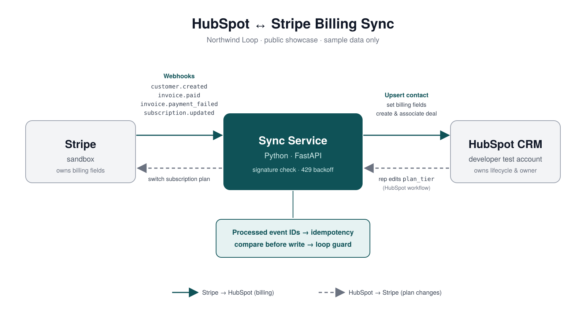

## Data model
- Custom property group **Billing (synced from Stripe)** on Contact and Company: `plan_tier`, `mrr`, `billing_status`, `stripe_customer_id`, `last_payment_date`, `sync_source`.
- Field ownership rules: [docs/source-of-truth.md](docs/source-of-truth.md)

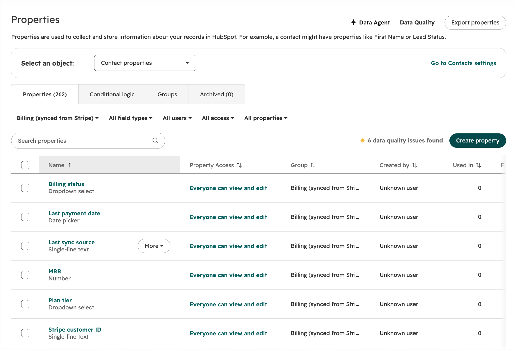
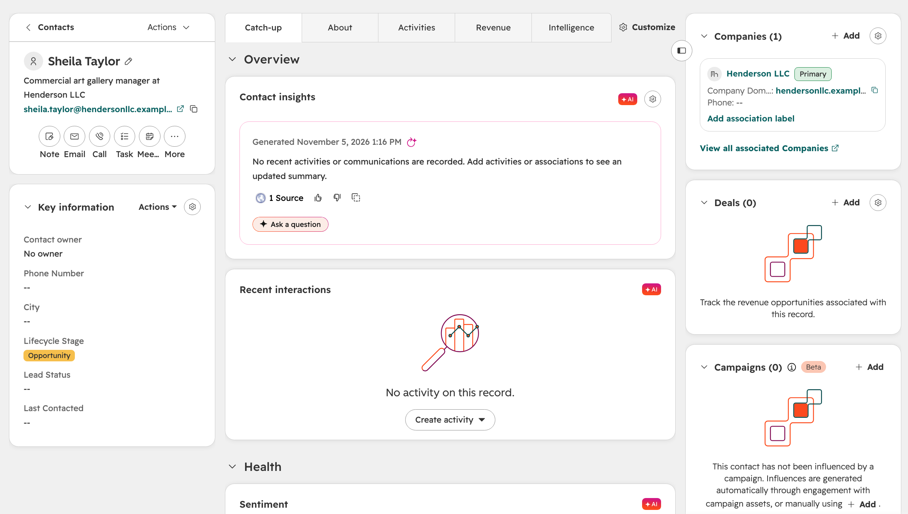

## Setup
1. `python -m venv .venv` and activate it, then `pip install -r requirements.txt`
2. `cp .env.example .env` and add a HubSpot **Service Key** (HubSpot stopped allowing new legacy private apps on Oct 26, 2026, so this project uses Service Keys).
3. `python scripts/generate_sample_data.py`
4. `python scripts/create_properties.py`
5. `python scripts/import_sample_data.py` (`scripts/reset_sample_data.py` archives the sample records if you want a clean reload)

## Sample data
30 fictional companies on reserved `example.com` subdomains with one or two contacts each, generated with a fixed seed so results are reproducible.

## Phase 2: Stripe → HubSpot sync
A FastAPI service receives Stripe webhooks and keeps HubSpot current. Stripe owns the billing fields; HubSpot keeps lifecycle and owner.

| Stripe event | HubSpot result |
|---|---|
| `customer.created` | Contact linked by email, company by domain, `stripe_customer_id` set |
| `customer.subscription.*` | Plan tier, MRR, billing status set; closed-won deal created once per subscription |
| `invoice.paid` | Billing status Active, last payment date set |
| `invoice.payment_failed` | Billing status **At risk** |

**Reliability**
- Webhook signature verified on every request; unsigned calls are rejected
- Idempotent: each Stripe event ID is applied once, so retries and duplicates are skipped
- Order-safe: an older event for the same subscription can't overwrite newer data
- HubSpot 429/5xx retried with backoff (honors `Retry-After`); failures return 500 so Stripe retries
- Helper scripts refuse to run with a live Stripe key

**Run it locally** (three terminals)
1. `stripe listen --events customer.created,customer.subscription.created,customer.subscription.updated,customer.subscription.deleted,invoice.paid,invoice.payment_failed --forward-to localhost:8000/webhooks/stripe`
2. `uvicorn app.main:app --port 8000`
3. `python scripts/seed_stripe.py` then `python scripts/simulate_payment_failure.py`

**After the sync** (contact record, billing fields filled by Stripe):

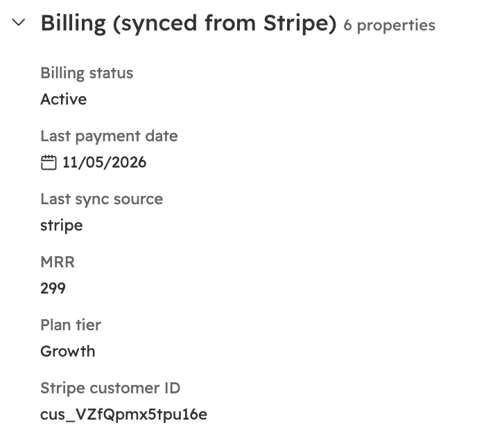

**Payment failure** flips the contact to At risk:

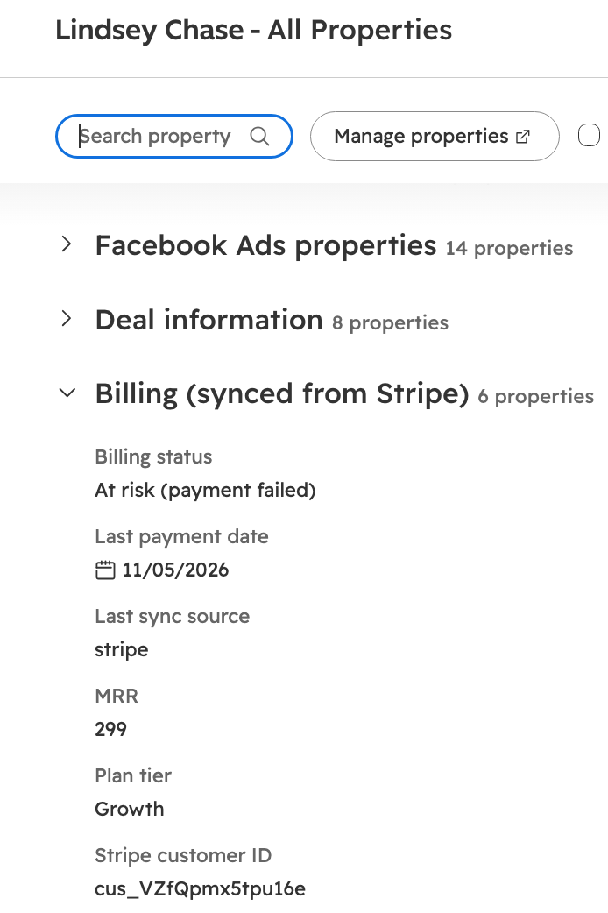

**Timeline**: deal created and closed-won by the integration; HubSpot then promotes the contact to Customer on its own:

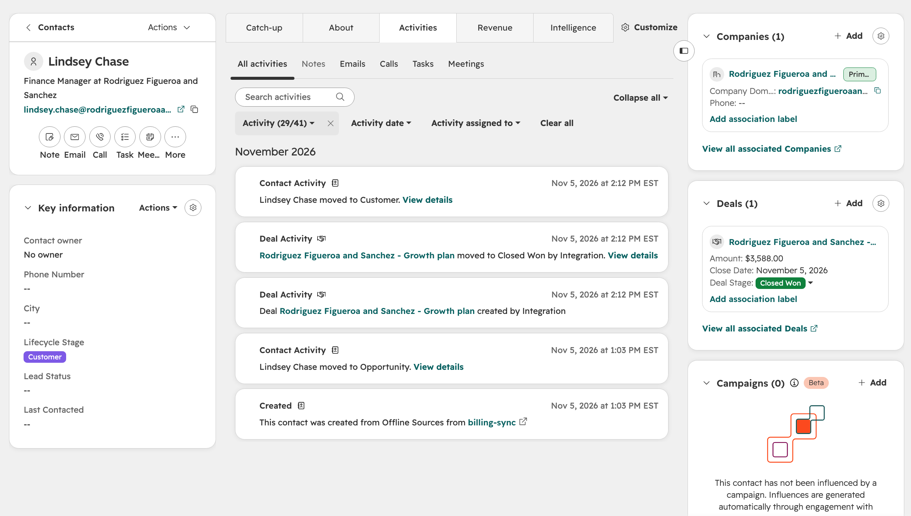

## Phase 3: HubSpot → Stripe plan changes
A sales rep changes **Plan tier** on a contact. A HubSpot workflow calls the sync service, which switches the Stripe subscription (with proration). Stripe confirms the change and Phase 2 writes the new MRR and deal amount back to HubSpot.

**Loop guard:** before writing, the service compares HubSpot's plan with what Stripe already has. If they match, it does nothing, so the two systems can never ping-pong.

**Security:** the workflow sends a shared secret in the `X-Sync-Secret` header (stored as a HubSpot secret); calls without it are rejected with 401.

**Resilience:** a dropped connection or HubSpot 429/5xx is retried with backoff. If processing still fails, the service returns 500 so HubSpot retries the webhook.

A real run, including an automatic retry after a dropped connection:

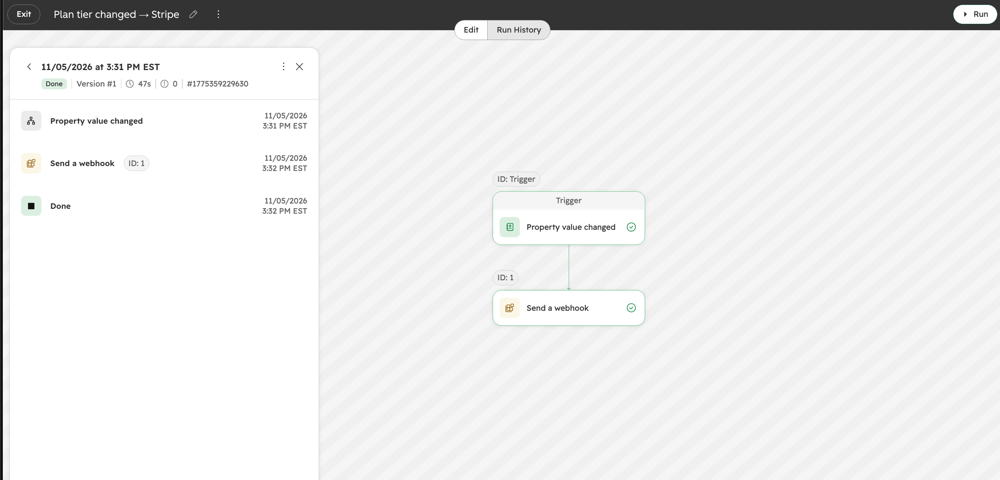

The result on the contact (Starter, $99 MRR):

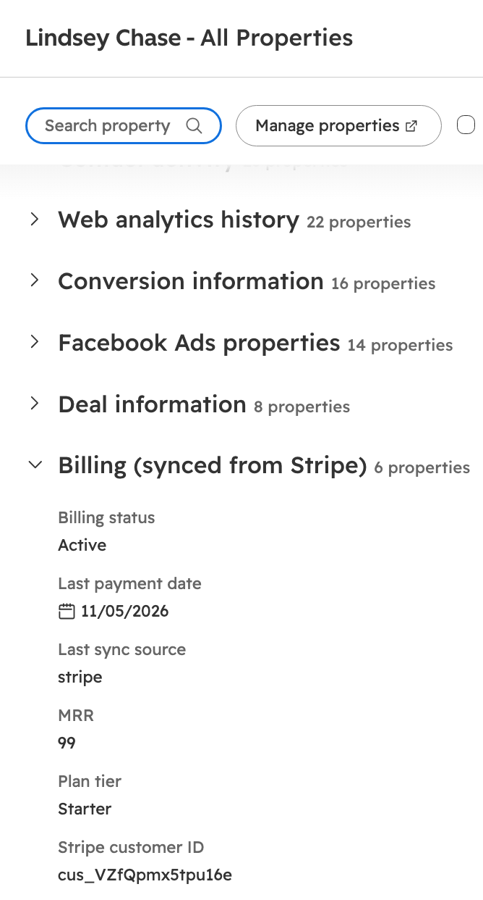

Round trip and loop guard in the service log:

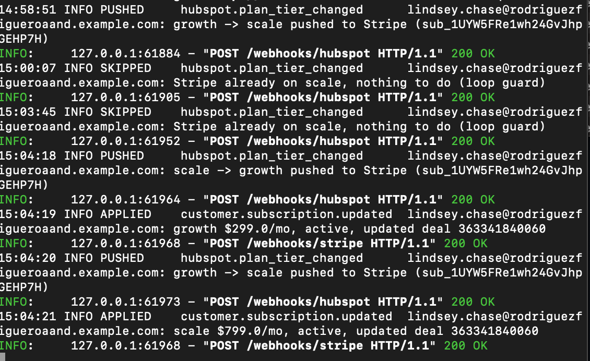

## Phase 4: Workflows, dashboard, tests

### HubSpot workflows
| Workflow | Trigger | Actions |
|---|---|---|
| **Payment failed → follow up** | Billing status becomes *At risk* | Create a task for the contact owner ("Call about failed payment", due today) |
| **New paid customer** | Billing status becomes *Active* | Set lifecycle stage to *Customer* |
| **Plan tier changed → Stripe** (Phase 3) | Plan tier changes | Send a webhook to the sync service |

The sync service only writes billing fields; HubSpot's own workflows decide what sales does about them. That keeps business rules where an admin can change them without a deploy.

A renewal fails, the account flips to At risk, and the owner gets a task:

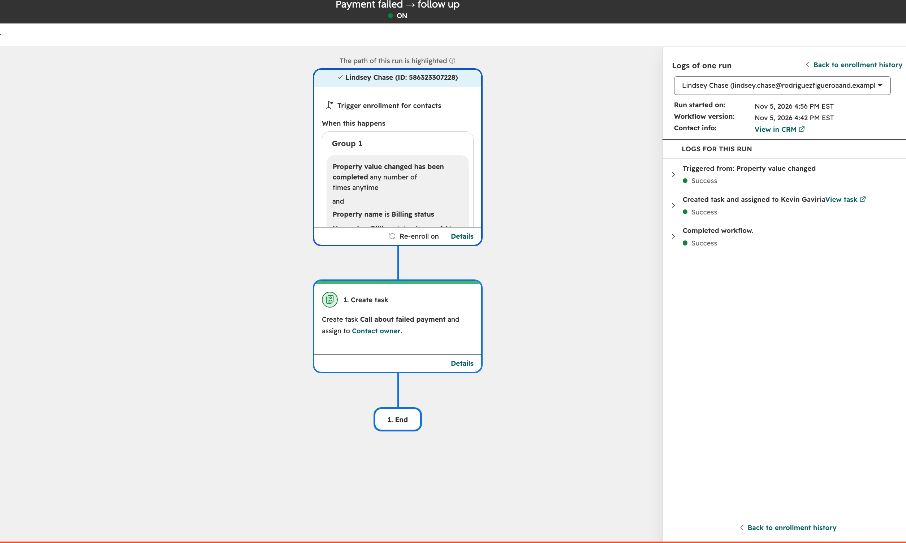

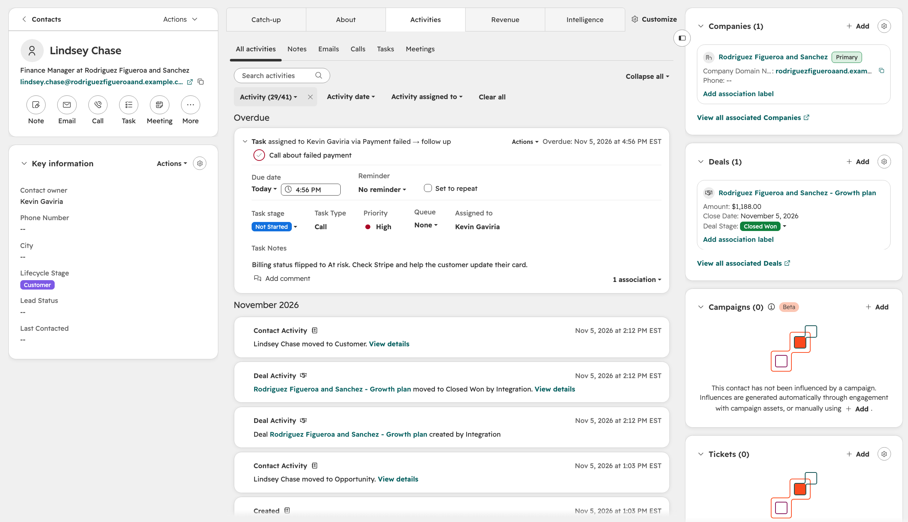

### Revenue dashboard
MRR by plan, new customers by month, at-risk accounts and the deal pipeline, built from the synced properties:

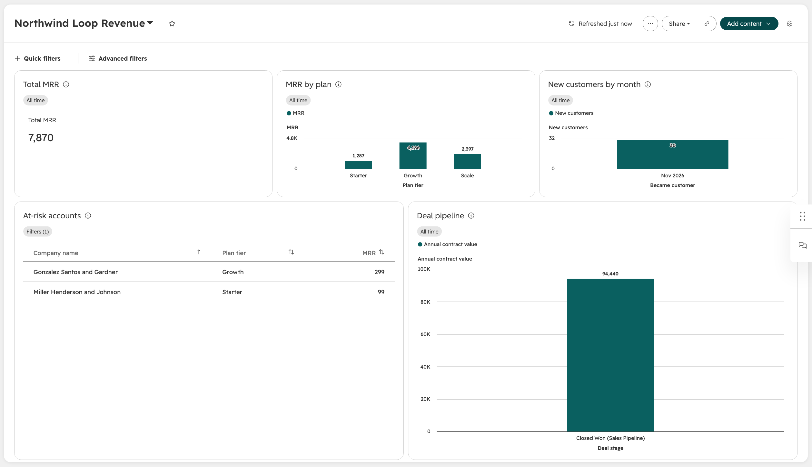

### Sequence: Stripe → HubSpot
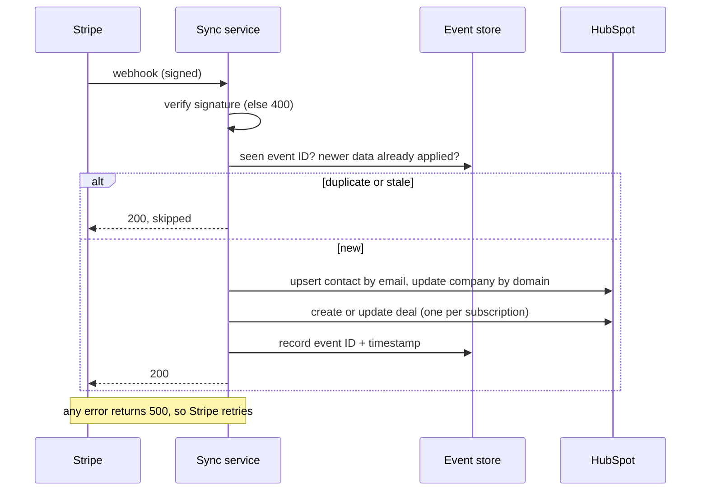

### Sequence: HubSpot → Stripe
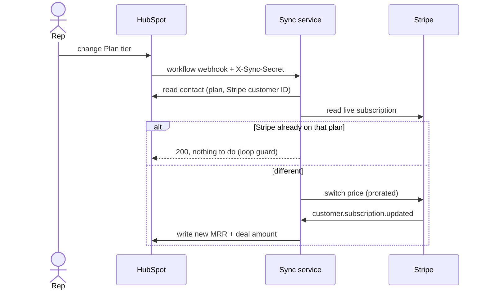

### Testing
- 89 tests with mocked HubSpot and Stripe; **100% line coverage** of `app/`, with CI failing below 95%
- Run on Python 3.9 and 3.12 on every push ([Actions](https://github.com/latin-guru/hubspot-stripe-sync/actions))
- Covers signature rejection, duplicates, out-of-order events, the loop guard, 429 `Retry-After`, 5xx backoff, dropped connections, and 500-so-the-sender-retries
- Run locally: `pip install -r requirements-dev.txt && pytest`

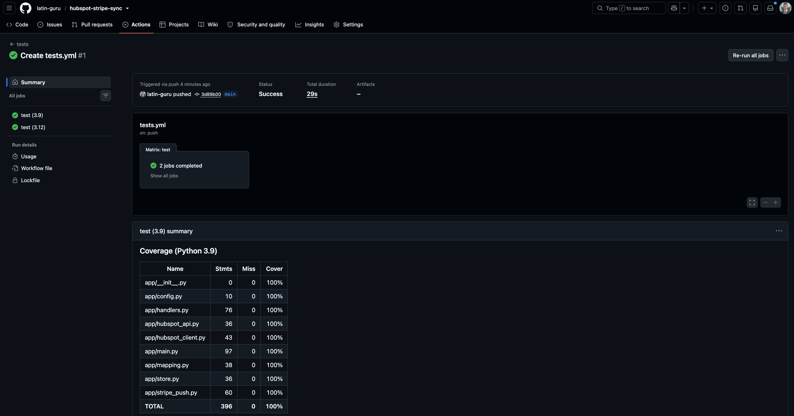

### Honest limits / what I'd do next
- **Sample scale.** 30 fake companies in a test account. Production would need a hosted service (not a laptop tunnel), monitoring and alerting.
- **SQLite event store.** Fine for one instance; multiple instances would need Postgres or Redis.
- **Reconciliation job.** Webhooks can be missed if the service is down longer than Stripe's retry window. A nightly job comparing Stripe and HubSpot would catch drift.
- **One subscription per customer.** Multiple subscriptions or seat-based pricing would need a richer model (e.g., a custom Subscription object in HubSpot).
- **Shared-secret auth** for the HubSpot workflow. A HubSpot developer-platform app could use HubSpot's request signatures instead.

## Contact
[LinkedIn: Kevin Gaviria](https://www.linkedin.com/in/kevin-gaviria)
